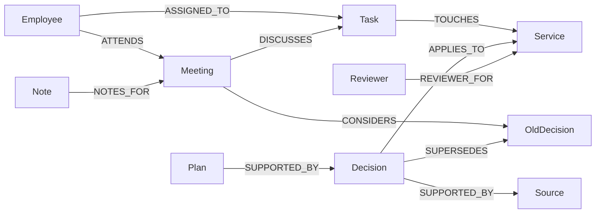

# Workweave

[](https://github.com/sasivarnan/workweave-falkordb/actions/workflows/verify.yml)

A company workspace that connects tasks, meetings, notes, knowledge, people, and source-backed decisions with FalkorDB.

**Status:** working local prototype for the Company Brain hackathon track. Public hosting and the final video remain release tasks. The sample has one employee and two assignments; the product direction serves all employees, but production identity and permissions are not implemented.

## Run locally

Requires Node.js 22+, Python 3.9+, and Docker.

```sh
docker compose up --build
```

Open http://localhost:8080. The database stays inside the Compose network. Named volumes keep graph data and the AI usage ledger. The portal binds to loopback.

For a local Python process instead:

```sh
docker run -d --name workweave-falkordb -p 127.0.0.1:6381:6379 falkordb/falkordb@sha256:b0bdcac2cbaff989e77cb0610439b7a9289e86de033ccbbd4368b66fb680ae7a
npm ci --prefix frontend
npm run build --prefix frontend
python3 -m venv .venv
.venv/bin/pip install -r requirements.txt
.venv/bin/python server.py
```

If a database already uses port 6381, reuse it. Do not start a second container on the same port.

The graph workspace does not need an AI key. Optional AI requires server settings from `.env.example`, a provider key, and an invite code. The app loads allowlisted values from an ignored `.env` file; process variables take priority. Never put keys in frontend code or commit them.

## Employee workflow

Today shows the next meeting, assigned work, schedule, and linked notes. Open a meeting brief to follow its stored links to a note or task. Search company documents from the header. Save a workspace note and switch between light and dark mode.

A task shows one next action: read current guidance → record required training → accept updated guidance if needed → save review notes → create a stored review request. The graph blocks that final action when required evidence, current guidance, notes, or the recorded reviewer is missing. Requests stay in the sample workspace; no email or calendar invitation is sent.

## Why relationships matter



An approved replacement can affect a task, a meeting that considered the earlier decision, and that meeting's notes. A saved plan keeps its decision identity so a replacement makes it stale. Missing ownership remains missing.

The relationship diagnostic changes edges while keeping source document IDs, titles, and bodies identical. Correct answers still change. Text alone cannot distinguish those states without relationship information. SQL with an equivalent relationship model could also solve them; this is not an exclusivity claim.

FalkorDB runs fixed parameterized Cypher, native `algo.SPpaths`, ID range indexes, document full-text lookup, and `GRAPH.EXPLAIN`. The latter is a query plan, not runtime profiling. See the generated [query catalogue](docs/CYPHER.md).

## AI and A2UI

The optional OpenAI or Gemini adapter calls the fixed `get_workspace_context` tool, then selects an allowlisted layout. The graph supplies displayed facts and action gates. There is no unrestricted generated factual narrative or model-generated Cypher.

The renderer supports a custom A2UI v0.9 subset: `createSurface`, `updateComponents`, and `updateDataModel`. It validates the catalog, tree, component IDs, types, and bindings. It is not a complete official SDK renderer. The catalog lives in `static/catalog.json`; the frontend copy must match.

UI controls use official shadcn base-rhea components, with the supplied violet/neutral preset, Public Sans, and Geist headings. Layout and transitions use Tailwind classes. The CSS file contains framework imports and theme tokens only.

## Validation

```sh
.venv/bin/python -m unittest discover -s tests -v
.venv/bin/python scripts/evaluate_relationships.py
.venv/bin/python scripts/evaluate.py
.venv/bin/python scripts/export_queries.py
npm run build --prefix frontend
.venv/bin/python scripts/check_secrets.py
```

The suite contains 33 tests. Integration tests create isolated disposable graphs and delete only those test graphs. Agent contract tests use mocked responses. The saved eight-case retrieval diagnostic and paired model evaluation are small authored checks, not production accuracy or general RAG benchmarks. See [evaluation details](EVALUATION.md).

## Local safety and deployment

Each visitor gets an isolated synthetic graph that expires after 24 hours of inactivity. Cookies are bearer credentials. No client-supplied graph name is accepted. AI calls require a server-configured invite code; the browser keeps it in memory only.

Default AI limits reserve 5 operations per rolling hour, 10 per rolling day, and 30 in total, globally. Each operation makes two provider calls. Reservations use SQLite and survive restarts only on persistent storage. General request limits and the 200-workspace cap are process-local. Use one application instance with persistent storage for the shared AI budget. These are operation limits, not a dollar cap.

Deploy only after the [predeployment checks](docs/PREDEPLOYMENT.md). Configure HTTPS, `COOKIE_SECURE=true`, a securely reachable FalkorDB instance, server-side secrets, and a persistent AI ledger. `render.yaml` is a starting configuration, not proof that a free host supplies persistent storage. Model access and provider billing must be verified for the account.

The rebrand uses a new workspace cookie, graph prefix, local preference keys, and A2UI catalog ID. It starts a fresh sample session. Existing local graph data is not deleted. The local Docker container can keep its existing runtime name; new setup instructions use the new project name.

## Limits

Synthetic records only. No production login, permission-aware queries, calendar sync, external messages, automatic source ingestion, full note CRUD, general company question answering, or project detail pages. Mobile and full keyboard review remain release checks.

## Hackathon materials

- [Submission draft](docs/SUBMISSION.md)
- [Demo script](DEMO-SCRIPT.md)
- [Blog draft](BLOG-DRAFT.md)
- [Rules and resource audit](docs/HACKATHON-AUDIT.md)
- [Participant review](docs/PARTICIPANT-REVIEW.md)
- [Company workspace plan](docs/COMPANY-WORKSPACE-PLAN.md)
- [Workspace redesign](docs/WORKSPACE-REDESIGN.md)

## AI assistance

Codex assisted with implementation, synthetic data, tests, design, and documentation. The participant must review the code, verify results, explain the implementation, and disclose assistance in the submission.

## References

- [Organizer graph-agent guide](https://www.wemakedevs.org/blogs/how-to-build-an-agent-that-reasons-over-a-graph)
- [FalkorDB algorithms](https://docs.falkordb.com/algorithms)
- [FalkorDB Cypher](https://docs.falkordb.com/cypher)
- [A2UI v0.9](https://a2ui.org/specification/v0.9-a2ui/)
