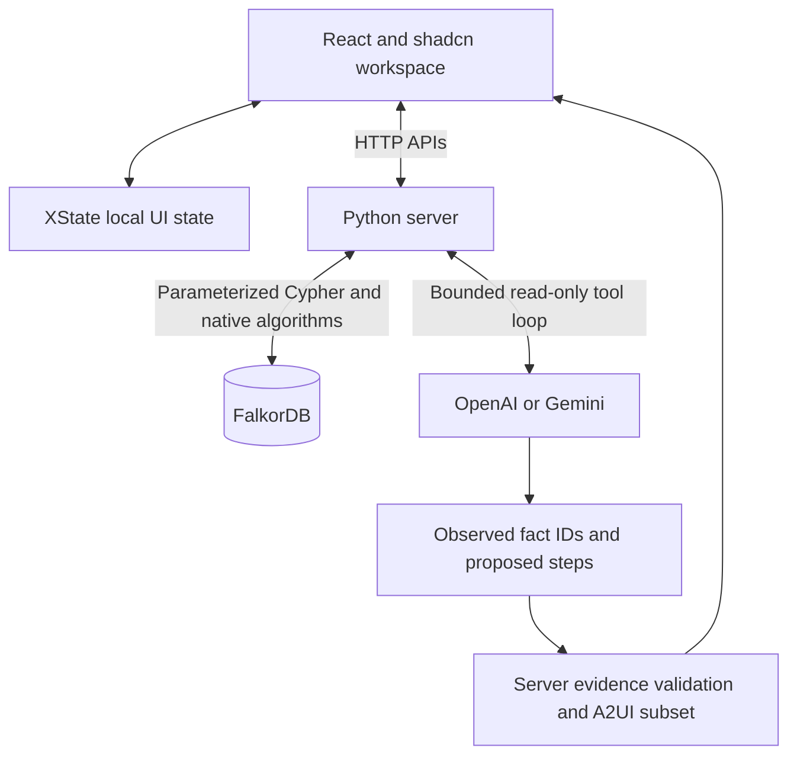
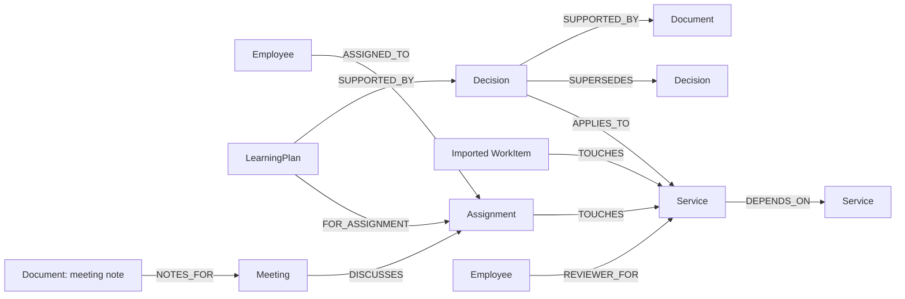
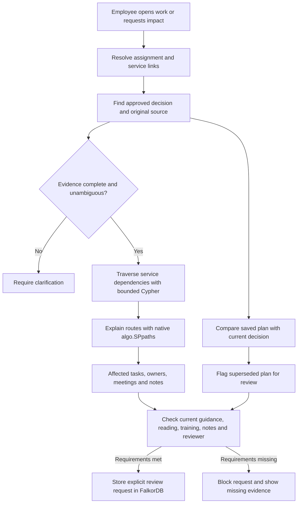

# Workweave

A company decision changes. Which saved plans need review, which teams are affected, and who can help? **Workweave** uses an agent and **FalkorDB** to answer these questions from connected company records. Built for the **Company Brain** hackathon track.

**Live demo:** [Open Workweave](https://workweave-falkordb.onrender.com/) · [Demo controls](https://workweave-falkordb.onrender.com/demo-controls) · [Project blog](https://dev.to/sasivarnan/one-changed-link-a-different-answer-workweave-with-falkordb-33e5)

Hosted on Render with FalkorDB Cloud. Synthetic data only. Stripe, Adyen, Razorpay and PayPal appear in a fictional payment-provider scenario; no real company decisions or integrations are implied. Final demo video is pending.

## Graph proof

Ask the agent what changed for Maya's checkout work. Its tools check the approved decision, saved plan, affected tasks and reviewers. Remove Billing → Checkout in Demo controls, then ask the same question again: Billing leaves the answer; Support stays through its alternate route. Source text remains unchanged. Maya must explicitly update her plan and create a review request.

See the [recorded live agent check](reports/agent-live.json), [validation limits](EVALUATION.md) and [Cypher catalogue](docs/CYPHER.md). The assistant opens from **Ask Workweave** beside the task, Decision review or Cross-team impact page.

### Review the main workflow

Use two tabs in the same browser session. AI checks require a configured server provider key.

1. In **Demo controls**, select **Reset and prepare story**, then **Approve sample replacement**.
2. Open **Maya’s task → Ask Workweave**. Ask: “What changed for my work, who else is affected, and whom should I ask? Include every affected task and its dependency route count.”
3. Expand **Why this answer?**. Check the approved source, old plan, Billing and Support’s two routes.
4. In Controls, select **Start dependency demo → Remove the test link**. Check that source text is unchanged.
5. Return to the task, refresh it and ask the same question. Billing leaves the answer; Support has one route. Restore the link in Controls.

This uses two agent checks. Each can make several model requests. If the hosted release differs, use the complete local setup below.

## Run

Choose **one** option. Run commands from the repository root.

**Open the application:** [http://localhost:8080](http://localhost:8080) after startup.

**Demo controls (optional):** [http://localhost:8080/demo-controls](http://localhost:8080/demo-controls).

### Option 1: Docker — application and database

Requires Docker with Compose. This builds and starts both services; no local uv or Node.js commands are needed.

```sh
docker compose up --build
```

### Option 2: uv — local application, database in Docker

Requires uv, Node.js 22+ and Docker. The `database` command below starts **only FalkorDB**. The final `uv run` starts the application on your machine.

```sh
uv sync --locked
npm ci --prefix frontend
npm run build --prefix frontend
docker compose -f compose.yaml -f compose.dev.yaml up -d database
uv run --locked workweave
```

If FalkorDB already runs at `127.0.0.1:6381`, skip the database command. Do not run the local app while the full Docker stack uses port 8080. To switch from Option 1, run `docker compose down` first; this retains named volumes. Avoid `down -v`, which deletes them.

For either option, open [localhost:8080](http://localhost:8080). Start tour explains the application; [/demo-controls](http://localhost:8080/demo-controls) provides optional graph and query evidence.

`uv sync --locked` rebuilds `.venv` from `uv.lock`. Keep `.env` when removing `.venv`. Optional AI is configured only on the server through [.env.example](.env.example). Graph workflows need no AI key.

## Deploy: Render + FalkorDB Cloud

[render.yaml](render.yaml) builds the existing Dockerfile as one web service: Python serves the UI and APIs. FalkorDB runs separately in FalkorDB Cloud. Docker Compose is for local use only.

1. Create a FalkorDB Cloud instance with **TLS enabled** and a public endpoint reachable from Render. Copy its host, port, username and password from the connection panel. Use the supplied database port, not a browser-console URL.
2. Push the tested source to GitHub. In Render, select **New → Blueprint** and connect this repository. Review the configuration before creating resources: it selects a **paid service**. The default region is Singapore; change it before creation if another region is closer to your database.
3. Enter `FALKORDB_HOST`, `FALKORDB_PORT`, `FALKORDB_USERNAME` and `FALKORDB_PASSWORD` when prompted. The Blueprint sets `FALKORDB_SSL=true`, `COOKIE_SECURE=true` and `WORKWEAVE_HOST=0.0.0.0`. Render supplies `PORT`; the server reads it automatically.
4. Deploy, then open the assigned `https://<service>.onrender.com` URL. Demo controls are at `/demo-controls`; the health check is `/api/health`. Automatic deployments are off; deploy later source updates manually after checks pass.
5. Verify Home, search, the tour and the remove/restore dependency proof in a fresh browser. If the cloud instance restricts incoming connections, allow the service's Render outbound IP ranges. Never put database credentials in frontend variables or source files.

**Optional AI:** graph workflows work without a provider key. To enable OpenAI, set `AI_PROVIDER=openai`, `OPENAI_API_KEY` and `OPENAI_MODEL` in Render's environment settings. Set `AI_ENABLED=false` to disable AI. Employees enter no key or invite. Keep keys on the server; never use a `VITE_` variable for secrets. Request limits, two concurrent agent slots and bounded model calls remain active. There is no persistent usage counter or application spending cap. Set provider spending controls and check your remaining credit.

**Free Render alternative:** create a free Docker web service with the same database and secure-cookie settings. AI can use the server's provider key. No persistent app disk is required; company data remains in FalkorDB Cloud. Free services sleep after inactivity, so the first visit can be slow.

The Blueprint contains no credentials and does not create the cloud database. Creating it in Render starts a public deployment. See [Render Blueprints](https://render.com/docs/blueprint-spec), [free-service limits](https://render.com/docs/free) and [outbound IP ranges](https://render.com/docs/outbound-ip-addresses).

## Development: frontend and backend separately

Run both terminals from the repository root. Install dependencies once:

```sh
uv sync --locked
npm ci --prefix frontend
```

Keep FalkorDB running at `127.0.0.1:6381`. Reuse your existing instance, or start only the database:

```sh
docker compose -f compose.yaml -f compose.dev.yaml up -d database
```

**Terminal 1 — backend with automatic restart:**

```sh
uv run --locked watchfiles 'workweave --api-only --port 8081' src/workweave
```

**Terminal 2 — frontend with hot reload:**

```sh
npm run dev --prefix frontend
```

Open [http://localhost:5173](http://localhost:5173). Vite forwards `/api` requests to the backend at `127.0.0.1:8081`. A frontend build is not required in this mode. Restart the backend after changing `.env`; only source files are watched. These servers do not use port 8080.

## Demo controls

Employee pages show work, guidance and source evidence. `/demo-controls` contains synthetic dependency and decision-change controls; optional validation details and query traces stay there. Use two tabs in the same browser session: trigger a change in one, then refresh the employee view in the other. This route separates presentation only; it is not an authentication boundary.

### Prepare or reset the demo

Open `/demo-controls` and select **Reset and prepare story**. It resets only this visitor graph, records sample reading and training, saves Maya’s original Adyen plan and imports the synthetic source records. Priya is the recorded approver of a later replacement; Leo remains the work reviewer. The controls simulate company events, not separate authenticated roles. Setup makes no AI calls.

For an empty workspace, use **Reset demo data → Reset this demo workspace**. Both actions remove this visitor’s saved notes, plans, progress, review requests and sample changes. They do not reset other visitors. Keep recording tabs in the same browser session and refresh the employee tab after a trigger. The presenter controls the pace.

## Record links

Person pages at `/people/<person-id>` show direct graph links and tasks reached through recorded service-review roles. The page groups work, services, decisions, meetings and other linked records, with a reason for each link. It does not infer a complete work history.

Task contacts open in a side panel at `/tasks/<assignment-id>/people`. Back closes the panel; a direct link or refresh restores it. `/people` lists the people recorded in the current workspace, including decision approvers. Contact details come from the graph; no email or chat action is shown without a configured channel.

Tasks, meetings and documents have direct links: `/tasks/checkout`, `/calendar/<event-id>` and `/knowledge/<document-id>`. Knowledge documents open on a dedicated reading page, separate from the list. Refresh restores the record; Back and Forward restore navigation. Closing a meeting opened from another page returns to that page. Search uses `/knowledge?q=...`. Record links use the current visitor workspace, not shared employee authentication.

## Project layout

```text
src/workweave/       Python package: HTTP server, graph, impact, AI, access and config
src/workweave/data/  Packaged synthetic source exports
frontend/           React application
scripts/            Reproducible evaluations and source checks
tests/              Backend and graph tests
docs/               API, graph queries and feature documentation
reports/            Reproducible validation results
pyproject.toml      Python metadata and direct dependencies
uv.lock             Locked Python dependencies
```

## Architecture



Company records and action checks come from the server and FalkorDB. The agent selects read-only tools for current decisions, saved plans, affected work and reviewers. It selects observed graph fact IDs and proposed next steps. The server rejects unknown facts, unchecked authority and stale results. It does not execute model-generated Cypher or let the agent change plans or approvals. Each operation allows at most five model calls and four distinct tools. Expand **Why this answer?** in the assistant to inspect the checked decision, saved plan, reviewer and dependency paths. This custom A2UI component uses graph data without another model call. The renderer supports a custom A2UI v0.9 subset, not a complete official SDK implementation.

| Agent tool | Graph work |
| --- | --- |
| `get_current_decision` | Resolve service scope, approval, replacement and source links ([query](docs/CYPHER.md#get_current_guidance)). |
| `inspect_saved_plan` | Compare the saved decision with current guidance. |
| `find_affected_work` | Follow directed dependencies up to five links ([query](docs/CYPHER.md#bounded_dependency_impact)); verify indirect explanations with native [`algo.SPpaths`](docs/CYPHER.md#native_dependency_explanation). |
| `find_reviewers` | Follow the selected service's reviewer and alternate-reviewer links ([query](docs/CYPHER.md#get_team_reviewers)). |

## Graph data model



Employees, assignments, services, decisions, documents and saved plans have stable IDs. Imported work items remain distinct from employee assignments. Approval and effective-time properties qualify decisions; a relationship alone does not establish authority.

## How FalkorDB drives the workflow



The graph links employees → assignments → services, decisions → sources, and saved plans → decision versions. Impact analysis follows up to five dependency links. Exact source IDs connect normalized synthetic Jira, Calendar and Zoom exports.

**Try the proof:** remove Billing → Checkout. The Billing task leaves the affected set; Support stays affected through another route. Restore the link to recover the original task IDs and route counts. Source content hashes remain equal. This proves relationship dependence in this implementation, not database exclusivity.

## Verify

With the local development database running:

```sh
uv run --locked python -m unittest discover -s tests -v
uv run --locked python scripts/evaluate_impact.py
uv run --locked python scripts/evaluate_relationships.py
uv run --locked python scripts/evaluate.py
uv run --locked python scripts/export_queries.py
uv run --locked ruff check src tests scripts
uv run --locked ruff format --check src tests scripts
npm test --prefix frontend
npm run build --prefix frontend
uv run --locked python scripts/check_secrets.py
```

Integration tests use disposable graphs. See [validation and limits](EVALUATION.md). The Python package can be checked separately with `uv build` and `uv run --locked workweave --help`.

## Documentation and limits

[API](docs/API.md) · [Cypher catalogue](docs/CYPHER.md) · [Cross-team impact](docs/CROSS-TEAM-IMPACT.md) · [Decision review](docs/DECISION-REVIEW.md)

Synthetic records only. No live Jira, Calendar or Zoom sync, production login, employee permissions, or external messages. AI access is controlled by server configuration and request limits; there is no employee authentication. Before public deployment, configure HTTPS, secure cookies, private database access and provider spending controls. Request limits are not a dollar cap.

**AI disclosure:** Codex assisted with implementation, tests, design and documentation. The participant is responsible for verification and technical understanding.

[MIT licence](LICENSE) · [FalkorDB documentation](https://docs.falkordb.com/) · [Hackathon](https://www.wemakedevs.org/hackathons/falkordb)
