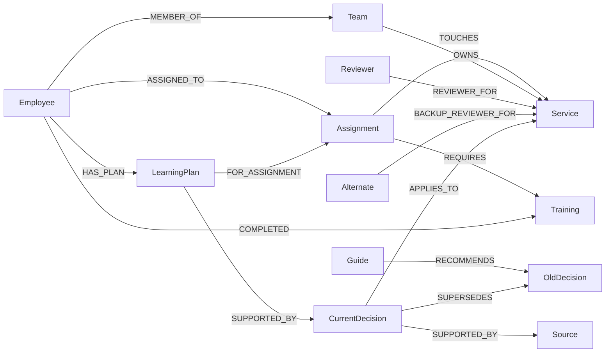

# FirstTask

A new employee portal that finds outdated guidance before a first contribution.

**Status:** working local graph workflow. OpenAI live function calling and layout selection passed. Public deployment still needs hosting configuration. Do not submit this as a completed hosted agent until those checks pass.

## Run locally

Requires Node.js 22+, Python 3.9+, and Docker. The container below is bound to loopback, not the public network.

```sh
docker run -d --name firsttask-falkordb -p 127.0.0.1:6381:6379 falkordb/falkordb:latest
npm ci --prefix frontend
npm run build --prefix frontend
python3 -m venv .venv
.venv/bin/pip install -r requirements.txt
.venv/bin/python server.py
```

Open http://localhost:8080. No model key is needed for explicitly labeled graph-tool exploration. Ask Agent needs a real OpenAI or Gemini key.

Set environment variables before starting the server. `.env.example` lists them; the app loads known settings from an ignored local `.env` file. Existing environment variables take priority. Store keys in your hosting secret settings or local process environment. Do not commit keys. `GEMINI_MODEL` is configurable; verify current model availability and your quota in AI Studio. The supplied model name is not a quota guarantee.

## Demo

Play Walkthrough runs real graph operations: reset the sample, inspect guidance, replace a decision, accept a plan, complete training, and retrieve state in a fresh request. The walkthrough does not consume model calls and is labeled accordingly. Ask Agent uses the configured provider’s function calling to read graph context and select the A2UI component order. Graph results supply displayed facts. There is no generated factual narrative.

Explore controls modify only the visitor's synthetic workspace. A changed decision preserves the accepted plan and flags it for review. Clearing the browser cookie starts a different workspace. Starting a new session preserves the workspace while discarding conversational context; the server does not retain model conversation history between requests.

## Graph model



Eighteen synthetic source documents are bundled. `graph.py` contains all fixed queries. The stale-guide query follows document → old decision ← replacement decision → service ← assignment. Native `algo.SPpaths` explains the employee-to-service path. Range indexes support ID lookup. Separate FalkorDB graphs isolate visitor workspaces.

The graph-depth comparison shows direct assignment sources and sources reached through typed relationships. It is not a retrieval benchmark. The application does not infer undocumented owners, trust recency alone, or claim that missing data means no risk.

## A2UI

The app implements a small custom renderer for an A2UI v0.9 subset: createSurface, updateComponents, and updateDataModel. The catalog is in `static/catalog.json`. It uses an allowlisted Column plus six domain components. It is not a complete general-purpose A2UI renderer or an official SDK. The server validates component selection; the browser validates message version, catalog, tree IDs, component types, and data bindings. Text values are escaped before display. Layout selection can change through the model. The graph-only mode uses a deterministic catalog layout.

## Deploy to Render

1. Put this directory in a public Git repository. Include the license and disclose AI assistance.
2. Create a Render Docker web service, or use `render.yaml`.
3. Provision a reachable FalkorDB instance. Configure host, port, username, password, and TLS settings. Use secure networking suitable for the provider; do not disable certificate checks.
4. Configure OPENAI_API_KEY, AI_PROVIDER=openai, and OPENAI_MODEL=gpt-6-luna, or use the Gemini settings. Verify model access for the account.
5. Set `COOKIE_SECURE=true` on the HTTPS deployment.
6. Run the workflow and live agent from the public URL. Check persistence after an app restart.

Render Free can sleep. Its filesystem is temporary. All onboarding state is stored in FalkorDB. Free FalkorDB availability, secure connectivity, persistence, and quota must be verified in the provider account. This repository does not provision a public database or paid services.

## Tests

```sh
.venv/bin/python -m unittest discover -s tests -v
```

Graph tests use isolated disposable graphs and delete only their own test graphs. An actual local FalkorDB instance is required. Agent contract tests use mocked responses and do not establish live model quality.

## Limits and release checks

- One employee, assignment, and synthetic company. No production HR integration or authentication.
- The local access-request feature and arbitrary document upload are not implemented.
- No email or real access grants are performed.
- The portal is not a production HR system.
- Demo controls include 30 requests per workspace per minute, 120 global requests per minute, 20 AI operations per hour, and two concurrent AI operations. Each AI operation uses two model calls. Demo graphs expire after 24 hours of inactivity. There is a 200-workspace process cap. These in-memory counters reset with the app; use durable limits and proxy protection before a larger public release.
- Workspace cookies are bearer credentials. No graph name is accepted from client input. Deploy behind HTTPS.
- Full official A2UI conformance validation, live Gemini verification, public deployment, video, baseline evaluation, and a real-user test remain release tasks.

## AI assistance

Built with Codex assistance for implementation, sample data, tests, design, and documentation. The participant must review the code and be able to explain it.

## References and Community Wisdom

- Organizer guide: https://www.wemakedevs.org/blogs/how-to-build-an-agent-that-reasons-over-a-graph
- FalkorDB algorithms: https://docs.falkordb.com/algorithms
- A2UI: https://a2ui.org/specification/v0.9-a2ui/
- Akash Pal, The A2UI Contract: https://dev.to/akashpal/the-a2ui-contract-a-deep-dive-into-agent-to-ui-architecture-4i00 — separates model-selected layout from computed data.

## OpenAI configuration

The OpenAI adapter uses function calling followed by schema-constrained layout selection. It sets store=false, caps completion tokens, and never displays the key. The current low-cost default is gpt-6-luna. Set AI_PROVIDER=openai and OPENAI_API_KEY in the ignored .env file or hosting secrets. Every agent operation makes two API calls and can incur API charges. .dockerignore excludes the local secret file from images.

## shadcn UI rewrite

The frontend uses the official shadcn base-rhea components and preset b3dlbUYd3w: violet theme, neutral base, Public Sans, and Geist headings. The final full stop in the supplied URL was punctuation and was removed after CLI validation. No custom UI widgets were added. App.tsx composes official components and maps existing A2UI domain descriptors to them. The descriptor names are not separate custom React components. Theme files and generated UI components come from the official CLI.

Build the frontend before starting Python. Docker builds it automatically. The local .env file is ignored and excluded from the build context. For both services with persistent graph storage, run docker compose up --build. The graph is private to the Compose network and uses a named /data volume with append-only persistence. The portal binds to localhost; a public host needs HTTPS ingress.

See RESOURCE-REVIEW.md for the resource audit. The execution view now includes GRAPH.EXPLAIN for the indexed assignment lookup. This is a query plan, not runtime profiling. /api/health checks database reachability.

## Minimal task screen

The main screen shows two cards: current guidance and next steps. People, saved progress, and relationship details are collapsed. Demo and judge controls are in the Demo tab. Evidence uses the official shadcn Trace component, with expandable queries and results. Trace rows are completed operations from the latest successful request; they are not live per-tool events. A request-level running indicator does not imply individual tools are streamed. The preset remains unchanged.

## Employee product workflow

The default route is an employee work view. The official shadcn Sidebar keeps My work, Knowledge, People, and both assigned tasks visible. The selected task has one primary next action, a requirement list, editable working notes, and a separate reviewer/source panel. The primary action changes after reading and training. The model-selected A2UI order controls the action, checklist, and notes sections. Choose checkout or refund testing. Every assignment resolves its own service, approved guidance, training, reviewer, and accepted plan from FalkorDB. Reading acknowledgements are linked to the current decision. Replacing that decision makes the new guidance unread. Progress measures required reading and training only; it does not claim that code review or the assignment is complete.

Ask for help is secondary. The assistant organizes graph-backed guidance; it does not provide an unrestricted chat response. Tool names and model status are hidden from the main employee view. A technical inspector remains available through Company knowledge.

The judge route is /judge. It includes walkthrough controls, graph mutation controls, and technical evidence. This route separation is a presentation choice, not an authorization boundary. All data is synthetic and scoped to the visitor workspace. The app still does not implement production employee authentication.
