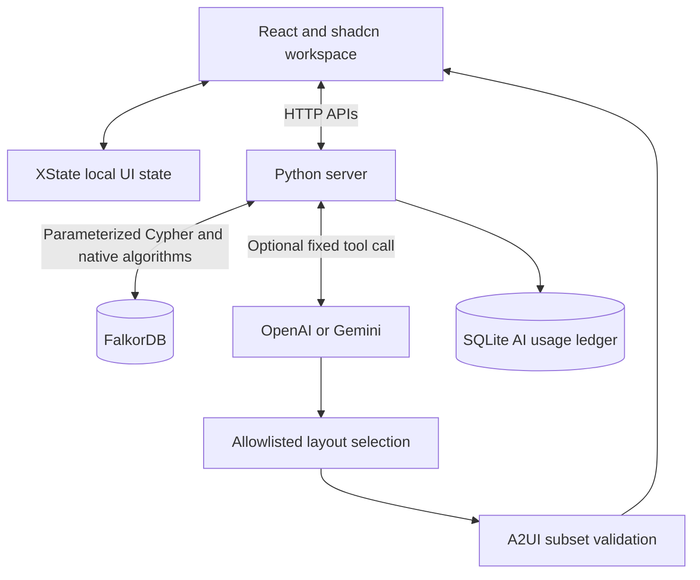
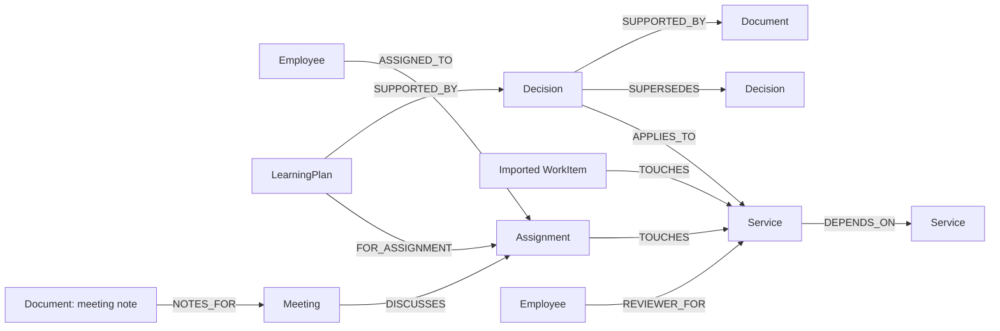
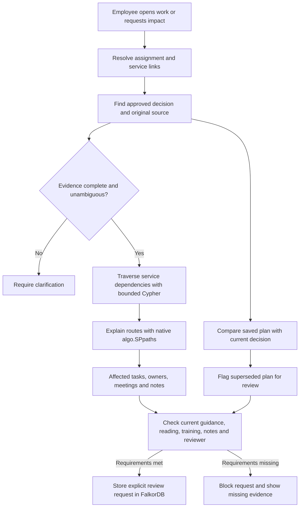

# Workweave

An employee workspace that connects tasks, meetings, notes, people and approved decisions through **FalkorDB**. Built for the **Company Brain** hackathon track.

**Live demo:** [Open Workweave](https://workweave-falkordb.onrender.com/) · [Technical proof](https://workweave-falkordb.onrender.com/judge)

Hosted on Render with FalkorDB Cloud. Synthetic data only. Stripe, Adyen, Razorpay and PayPal appear in a fictional payment-provider scenario; no real company decisions or integrations are implied. Final demo video is pending.

## Run

Choose **one** option. Run commands from the repository root.

**Open the application:** [http://localhost:8080](http://localhost:8080) after startup.

**Technical proof (optional):** [http://localhost:8080/judge](http://localhost:8080/judge).

### Option 1: Docker — application and database

Requires Docker with Compose. This builds and starts both services; no local uv or Node.js commands are needed.

```sh
docker compose up --build
```

### Option 2: uv — local application, database in Docker

Requires uv, Node.js 22+ and Docker. The `database` command below starts **only FalkorDB**. The final `uv run` starts the application on your machine.

```sh
uv sync --locked
npm ci --prefix frontend
npm run build --prefix frontend
docker compose -f compose.yaml -f compose.dev.yaml up -d database
uv run --locked workweave
```

If FalkorDB already runs at `127.0.0.1:6381`, skip the database command. Do not run the local app while the full Docker stack uses port 8080. To switch from Option 1, run `docker compose down` first; this retains named volumes. Avoid `down -v`, which deletes them.

For either option, open [localhost:8080](http://localhost:8080). Start tour explains the application; [/judge](http://localhost:8080/judge) provides optional graph and query evidence.

`uv sync --locked` rebuilds `.venv` from `uv.lock`. Keep `.env` and `.data/` when removing `.venv`. Optional AI uses [.env.example](.env.example) and a separate invite code. Graph workflows need no AI key.

## Deploy: Render + FalkorDB Cloud

[render.yaml](render.yaml) builds the existing Dockerfile as one web service: Python serves the UI and APIs. FalkorDB runs separately in FalkorDB Cloud. Docker Compose is for local use only.

1. Create a FalkorDB Cloud instance with **TLS enabled** and a public endpoint reachable from Render. Copy its host, port, username and password from the connection panel. Use the supplied database port, not a browser-console URL.
2. Push the tested source to GitHub. In Render, select **New → Blueprint** and connect this repository. Review the configuration before creating resources: it selects a **paid service and 1 GB persistent disk**. The default region is Singapore; change it before creation if another region is closer to your database.
3. Enter `FALKORDB_HOST`, `FALKORDB_PORT`, `FALKORDB_USERNAME` and `FALKORDB_PASSWORD` when prompted. The Blueprint sets `FALKORDB_SSL=true`, `COOKIE_SECURE=true` and `WORKWEAVE_HOST=0.0.0.0`. Render supplies `PORT`; the server reads it automatically.
4. Deploy, then open the assigned `https://<service>.onrender.com` URL. Technical proof is at `/judge`; the health check is `/api/health`. Automatic deployments are off; deploy later source updates manually after checks pass.
5. Verify Home, search, the tour and the remove/restore dependency proof in a fresh browser. If the cloud instance restricts incoming connections, allow the service's Render outbound IP ranges. Never put database credentials in frontend variables or source files.

**Optional AI:** graph workflows work without a provider key. To enable OpenAI, add `AI_PROVIDER=openai`, `OPENAI_API_KEY`, `OPENAI_MODEL` and a separate random `AI_ACCESS_CODE` of at least 16 characters in Render's environment settings. Choose a model supported by your API account. Do not use a `VITE_` variable for secrets. The disk retains `AI_USAGE_DB=/app/.data/ai-usage.sqlite3` across restarts; limits default to 5 operations/hour, 10/day and 30 total. Set provider spending controls too. Keep one app instance for this SQLite ledger. Confirm one successful invited call and that the ledger remains after a restart before sharing paid access.

**Free Render alternative:** create a Docker web service manually, use the same database and secure-cookie settings, and omit the disk. Leave provider keys and `AI_ACCESS_CODE` unset. Free services sleep after inactivity and lose local files on restart, so they cannot retain our AI usage ledger. Company data remains in FalkorDB Cloud. The paid configuration is preferable for judge visits.

The Blueprint contains no credentials and does not create the cloud database. Creating it in Render starts a public deployment. See [Render Blueprints](https://render.com/docs/blueprint-spec), [free-service limits](https://render.com/docs/free) and [outbound IP ranges](https://render.com/docs/outbound-ip-addresses).

## Development: frontend and backend separately

Run both terminals from the repository root. Install dependencies once:

```sh
uv sync --locked
npm ci --prefix frontend
```

Keep FalkorDB running at `127.0.0.1:6381`. Reuse your existing instance, or start only the database:

```sh
docker compose -f compose.yaml -f compose.dev.yaml up -d database
```

**Terminal 1 — backend with automatic restart:**

```sh
uv run --locked watchfiles 'workweave --api-only --port 8081' src/workweave
```

**Terminal 2 — frontend with hot reload:**

```sh
npm run dev --prefix frontend
```

Open [http://localhost:5173](http://localhost:5173). Vite forwards `/api` requests to the backend at `127.0.0.1:8081`. A frontend build is not required in this mode. Restart the backend after changing `.env`; only source files are watched. These servers do not use port 8080.

## Record links

Tasks, meetings and documents have direct links: `/tasks/checkout`, `/calendar/<event-id>` and `/knowledge/<document-id>`. Knowledge documents open on a dedicated reading page, separate from the list. Refresh restores the record; Back and Forward restore navigation. Closing a meeting opened from another page returns to that page. Search uses `/knowledge?q=...`. Record links use the current visitor workspace, not shared employee authentication.

## Project layout

```text
src/workweave/       Python package: HTTP server, graph, impact, AI, access and config
src/workweave/data/  Packaged synthetic source exports
frontend/           React application
scripts/            Reproducible evaluations and source checks
tests/              Backend and graph tests
docs/               API, graph queries and feature documentation
reports/            Reproducible validation results
pyproject.toml      Python metadata and direct dependencies
uv.lock             Locked Python dependencies
```

## Architecture



Company records and action checks come from the server and FalkorDB. AI selects component order; it does not generate company facts or arbitrary Cypher. The renderer supports a custom A2UI v0.9 subset, not a complete official SDK implementation. SQLite stores AI usage limits only.

## Graph data model



Employees, assignments, services, decisions, documents and saved plans have stable IDs. Imported work items remain distinct from employee assignments. Approval and effective-time properties qualify decisions; a relationship alone does not establish authority.

## How FalkorDB drives the workflow



The graph links employees → assignments → services, decisions → sources, and saved plans → decision versions. Impact analysis follows up to five dependency links. Exact source IDs connect normalized synthetic Jira, Calendar and Zoom exports.

**Try the proof:** remove Billing → Checkout. The Billing task leaves the affected set; Support stays affected through another route. Restore the link to recover the original task IDs and route counts. Source content hashes remain equal. This proves relationship dependence in this implementation, not database exclusivity.

## Verify

With the local development database running:

```sh
uv run --locked python -m unittest discover -s tests -v
uv run --locked python scripts/evaluate_impact.py
uv run --locked python scripts/evaluate_relationships.py
uv run --locked python scripts/evaluate.py
uv run --locked python scripts/export_queries.py
uv run --locked ruff check src tests scripts
uv run --locked ruff format --check src tests scripts
npm test --prefix frontend
npm run build --prefix frontend
uv run --locked python scripts/check_secrets.py
```

Integration tests use disposable graphs. See [validation and limits](EVALUATION.md). The Python package can be checked separately with `uv build` and `uv run --locked workweave --help`.

## Documentation and limits

[API](docs/API.md) · [Cypher catalogue](docs/CYPHER.md) · [Cross-team impact](docs/CROSS-TEAM-IMPACT.md) · [Decision review](docs/DECISION-REVIEW.md)

Synthetic records only. No live Jira, Calendar or Zoom sync, production login, employee permissions, or external messages. A shared invite protects optional paid AI; it is not employee authentication. Before public deployment, configure HTTPS, secure cookies, private database access, persistent storage and provider spending controls. Application operation limits are not a dollar cap.

**AI disclosure:** Codex assisted with implementation, tests, design and documentation. The participant is responsible for verification and technical understanding.

[MIT licence](LICENSE) · [FalkorDB documentation](https://docs.falkordb.com/) · [Hackathon](https://www.wemakedevs.org/hackathons/falkordb)
