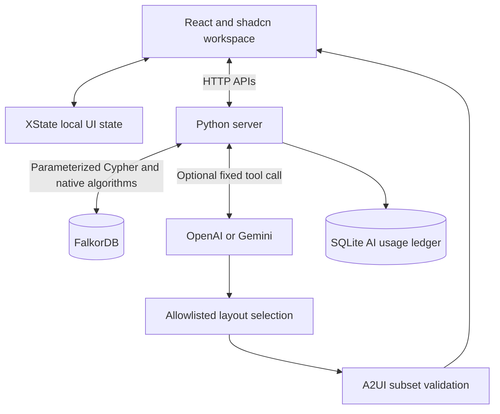
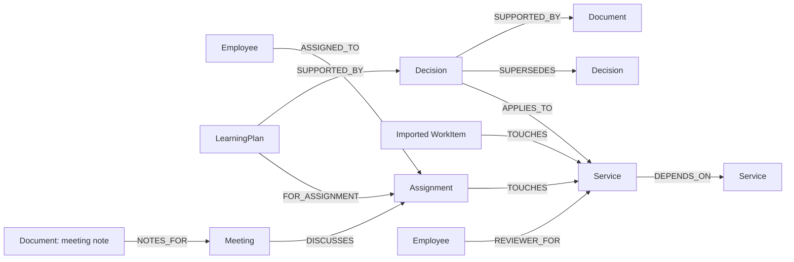
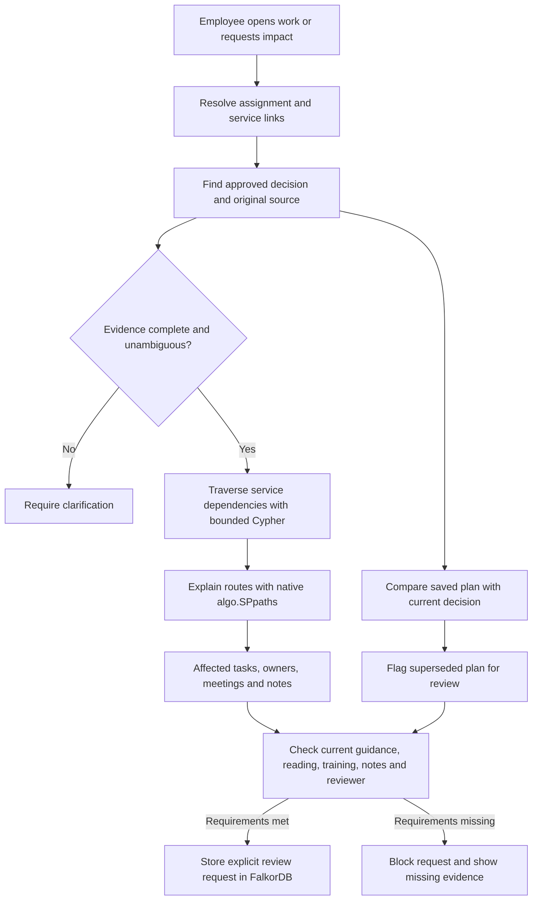

# Workweave

An employee workspace that connects tasks, meetings, notes, people and approved decisions through **FalkorDB**. Built for the **Company Brain** hackathon track.

**Status:** working local prototype with synthetic data. Public demo and final video are pending.

## Run

Requires Docker with Compose.

```sh
docker compose up --build
```

Open [localhost:8080](http://localhost:8080). Start tour in the header explains the employee application. Open [/judge](http://localhost:8080/judge) for the interactive graph proof and evaluation evidence.

Graph workflows need no AI key. Optional AI uses server-only settings from [.env.example](.env.example) and a separate invite code. Never put a provider key in the frontend. Named volumes retain graph data and the AI usage ledger.

## Architecture



Company records and action checks come from the server and FalkorDB. AI selects component order; it does not generate company facts or arbitrary Cypher. The renderer supports a custom A2UI v0.9 subset, not a complete official SDK implementation. SQLite stores AI usage limits only.

## Graph data model



Employees, assignments, services, decisions, documents and saved plans have stable IDs. Imported work items remain distinct from employee assignments. Approval and effective-time properties qualify decisions; a relationship alone does not establish authority.

## How FalkorDB drives the workflow



The graph links employees → assignments → services, decisions → sources, and saved plans → decision versions. Impact analysis follows up to five dependency links. Exact source IDs connect normalized synthetic Jira, Calendar and Zoom exports.

**Try the proof:** remove Billing → Checkout. The Billing task leaves the affected set; Support stays affected through another route. Restore the link to recover the original task IDs and route counts. Source content hashes remain equal. This proves relationship dependence in this implementation, not database exclusivity.

## Verify

With Python 3.9+, Node.js 22+ and FalkorDB available on port 6381:

```sh
python3 -m venv .venv
.venv/bin/pip install -r requirements.txt
.venv/bin/python -m unittest discover -s tests -v
.venv/bin/python scripts/evaluate_impact.py
.venv/bin/python scripts/evaluate_relationships.py
.venv/bin/python scripts/evaluate.py
npm ci --prefix frontend
npm test --prefix frontend
npm run build --prefix frontend
.venv/bin/python scripts/check_secrets.py
```

Compose keeps FalkorDB private. For host-side tests, use a separate local FalkorDB instance exposed only on `127.0.0.1:6381`, or set `FALKORDB_HOST` and `FALKORDB_PORT` to a reachable test instance. Tests create disposable graphs. See [validation and limits](EVALUATION.md).

## Documentation and limits

[API](docs/API.md) · [Cypher catalogue](docs/CYPHER.md) · [Cross-team impact](docs/CROSS-TEAM-IMPACT.md) · [Decision review](docs/DECISION-REVIEW.md)

Synthetic records only. No live Jira, Calendar or Zoom sync, production login, employee permissions, or external messages. A shared invite protects optional paid AI; it is not employee authentication. Before public deployment, configure HTTPS, secure cookies, private database access, persistent storage and provider spending controls. Application operation limits are not a dollar cap.

**AI disclosure:** Codex assisted with implementation, tests, design and documentation. The participant is responsible for verification and technical understanding.

[MIT licence](LICENSE) · [FalkorDB documentation](https://docs.falkordb.com/) · [Hackathon](https://www.wemakedevs.org/hackathons/falkordb)
