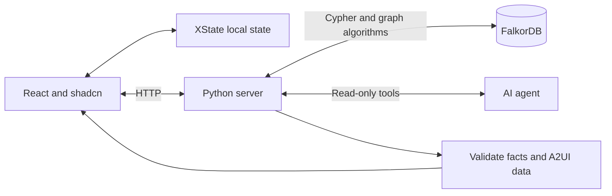
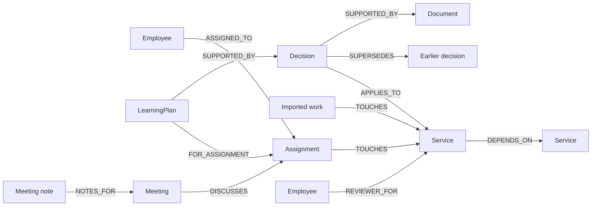
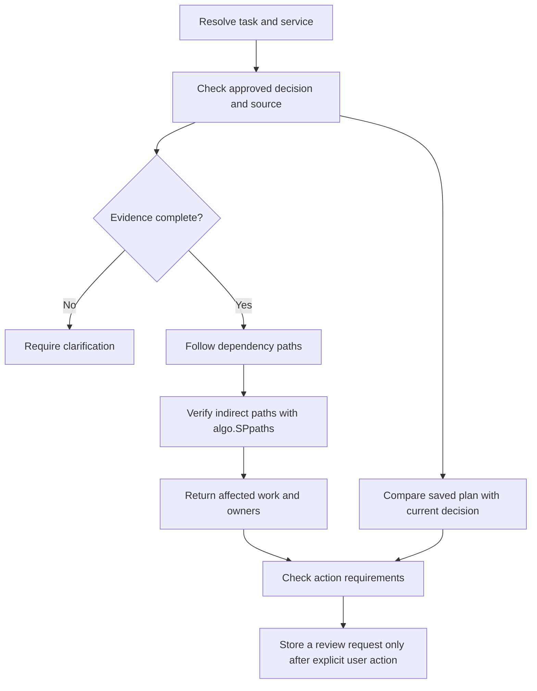

# Workweave

Workweave connects company decisions to the work they affect. Its agent finds saved plans that need review, affected tasks and linked reviewers. **FalkorDB** stores the records and relationships.

**Hackathon track:** Company Brain.

## Setup

Run commands from the repository root. Choose one option.

### Docker

Requires Docker with Compose. This starts the application and FalkorDB.

```sh
docker compose up --build
```

### uv

Requires uv, Node.js 22+ and Docker. Docker starts only the database. The final command starts the application.

```sh
uv sync --locked
npm ci --prefix frontend
npm run build --prefix frontend
docker compose -f compose.yaml -f compose.dev.yaml up -d database
uv run --locked workweave
```

Open [http://localhost:8080](http://localhost:8080). Skip the database command if FalkorDB already runs on port 6381. Stop the full Docker stack before you start the local application on the same port. `docker compose down` retains the database volume.

### AI settings

Graph workflows work without an AI key. To use the agent, configure `AI_PROVIDER`, `OPENAI_API_KEY` and `OPENAI_MODEL` on the server. For local use, copy [.env.example](.env.example) to `.env` and enter your settings. Keep an existing `.env` when you rebuild `.venv`.

Set `AI_ENABLED=false` to disable AI. Keep keys out of browser variables and source control. Request limits are not a spending cap.

### Development

Run `uv sync --locked` and `npm ci --prefix frontend` once. Keep FalkorDB running on port 6381. Start each process in a separate terminal:

```sh
# Backend: port 8081, with automatic restart
uv run --locked watchfiles 'workweave --api-only --port 8081' src/workweave
```

```sh
# Frontend
npm run dev --prefix frontend
```

Open [http://localhost:5173](http://localhost:5173). Vite forwards API requests to port 8081. Restart the backend after a change to `.env`.

For hosting, see [Render and FalkorDB Cloud setup](docs/DEPLOYMENT.md).

## Architecture



The agent selects graph tools and observed fact IDs. The server rejects unknown facts and changed evidence. It allows at most five model calls per request. The agent cannot approve decisions, update plans or send messages.

The interface uses a custom A2UI v0.9 subset with shadcn controls. It is not a complete A2UI SDK implementation.

## Graph data model



Records have stable IDs. A saved plan keeps its decision ID. Approval, source support and effective time determine current guidance. Newer text alone does not establish approval.

## FalkorDB workflow



Bounded Cypher finds routes up to five links long. Native `algo.SPpaths` verifies an indirect explanation. Alternate routes remain in the result. Exact source IDs link synthetic task, calendar and meeting-note exports.

## Queries and agent tools

| Agent tool | Graph operation |
| --- | --- |
| `get_current_decision` | [Resolve approved guidance and its source](docs/CYPHER.md#get_current_guidance). |
| `inspect_saved_plan` | Compare the saved decision with current guidance. |
| `find_affected_work` | [Find dependency routes](docs/CYPHER.md#bounded_dependency_impact) and [verify native paths](docs/CYPHER.md#native_dependency_explanation). |
| `find_reviewers` | [Find linked reviewers](docs/CYPHER.md#get_team_reviewers). |

The [Cypher catalogue](docs/CYPHER.md) contains the graph queries. See [API](docs/API.md), [decision review](docs/DECISION-REVIEW.md) and [cross-team impact](docs/CROSS-TEAM-IMPACT.md) for details.

## Validation and limits

With the local development database running:

```sh
uv run --locked python -m unittest discover -s tests -v
npm test --prefix frontend
npm run build --prefix frontend
```

See [test results and reproduction steps](EVALUATION.md). Integration tests use disposable graphs. The [recorded live agent check](reports/agent-live.json) contains two real provider runs on one synthetic scenario.

The project has no live Jira, Calendar or Zoom sync, production login, employee permissions or external messages. A visitor cookie selects an isolated sample graph. Missing links can hide affected work. These checks are not production accuracy or scale tests.

**AI disclosure:** Codex assisted with code, tests, design and documents. The participant must verify the work and explain the technical choices.

[MIT licence](LICENSE) · [Hackathon rules](https://www.wemakedevs.org/hackathons/falkordb/rules)

## Demo

[Hosted app](https://workweave-falkordb.onrender.com/) · [Demo controls](https://workweave-falkordb.onrender.com/demo-controls) · [Project blog](https://dev.to/sasivarnan/one-changed-link-a-different-answer-workweave-with-falkordb-33e5)

The hosted build is older than the latest tested source. Use local setup for the latest interface. **Demo video: pending.**

Use two tabs in the same browser session. The agent needs a configured provider key.

1. Open `/demo-controls`. Select **Reset and prepare story**, then **Approve sample replacement**.
2. Open **Maya’s task → Ask Workweave**. Ask: “What changed for my work, who else is affected, and whom should I ask? Include every affected task and its dependency route count.”
3. Open **Why this answer?**. Check the source, old plan, Billing and Support’s two routes.
4. In Controls, select **Start dependency demo → Remove the test link**. Source text stays unchanged.
5. Refresh the task and ask the same question. Billing leaves the answer; Support has one route. Restore the link in Controls.

This uses two agent checks. Each can make several model requests. The test shows that relationships control the answer; it does not prove that other databases cannot implement the same logic.

**Reset and prepare story** resets only this visitor’s graph and saves Maya’s original Adyen plan. For an empty workspace, select **Reset demo data → Reset this demo workspace**. Reset removes this visitor’s notes, plans, progress and review requests.

All company records are synthetic. Payment-provider names are illustrative. The controls simulate events; they do not represent separate authenticated users. Setup makes no AI calls.
