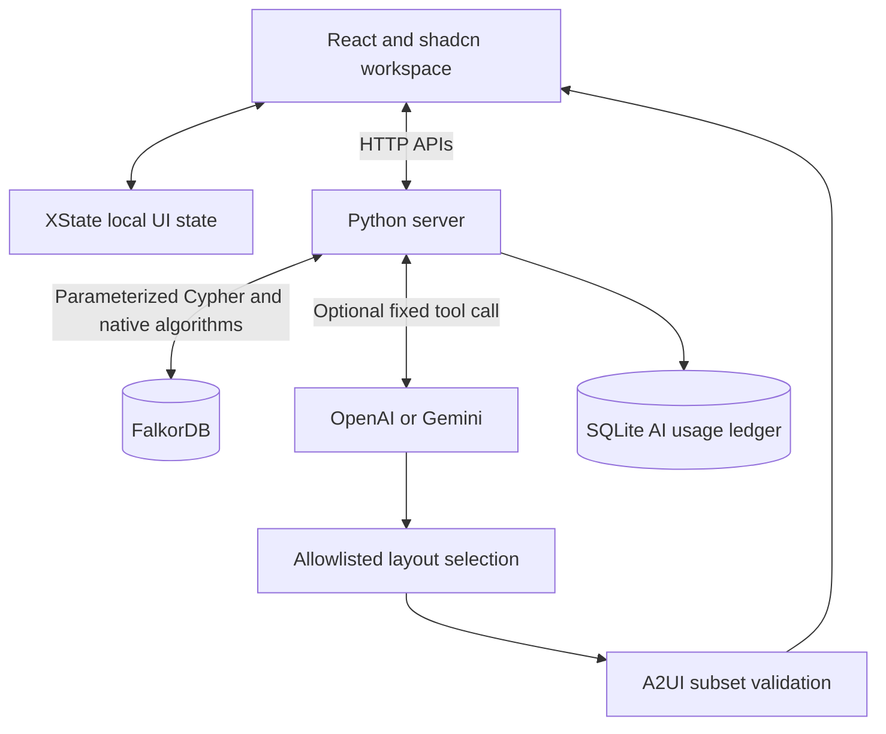
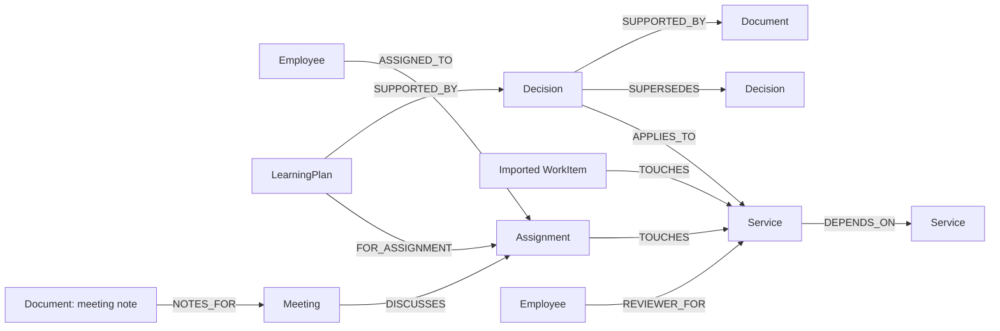
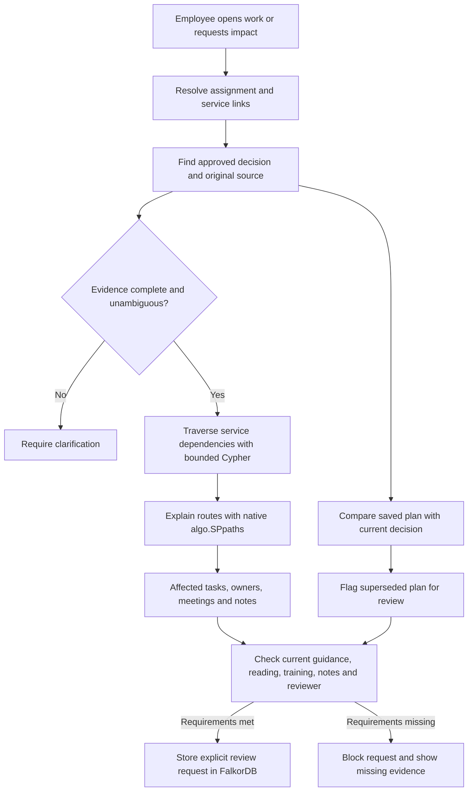

# Workweave

An employee workspace that connects tasks, meetings, notes, people and approved decisions through **FalkorDB**. Built for the **Company Brain** hackathon track.

**Status:** working local prototype with synthetic data. Public demo and final video are pending.

## Run

Choose **one** option. Run commands from the repository root.

**Open the application:** [http://localhost:8080](http://localhost:8080) after startup.

**Technical proof (optional):** [http://localhost:8080/judge](http://localhost:8080/judge).

### Option 1: Docker — application and database

Requires Docker with Compose. This builds and starts both services; no local uv or Node.js commands are needed.

```sh
docker compose up --build
```

### Option 2: uv — local application, database in Docker

Requires uv, Node.js 22+ and Docker. The `database` command below starts **only FalkorDB**. The final `uv run` starts the application on your machine.

```sh
uv sync --locked
npm ci --prefix frontend
npm run build --prefix frontend
docker compose -f compose.yaml -f compose.dev.yaml up -d database
uv run --locked workweave
```

If FalkorDB already runs at `127.0.0.1:6381`, skip the database command. Do not run the local app while the full Docker stack uses port 8080. To switch from Option 1, run `docker compose down` first; this retains named volumes. Avoid `down -v`, which deletes them.

For either option, open [localhost:8080](http://localhost:8080). Start tour explains the application; [/judge](http://localhost:8080/judge) provides optional graph and query evidence.

`uv sync --locked` rebuilds `.venv` from `uv.lock`. Keep `.env` and `.data/` when removing `.venv`. Optional AI uses [.env.example](.env.example) and a separate invite code. Graph workflows need no AI key.

## Development: frontend and backend separately

Install dependencies once with `uv sync --locked` and `npm ci --prefix frontend`. Keep FalkorDB running at `127.0.0.1:6381`; reuse an existing instance or start the database with the development Compose command above.

**Terminal 1 — backend with automatic restart:**

```sh
uv run --locked watchfiles 'workweave --api-only --port 8081' src/workweave
```

**Terminal 2 — frontend with hot reload:**

```sh
npm run dev --prefix frontend
```

Open [http://localhost:5173](http://localhost:5173). Vite forwards `/api` requests to the backend at `127.0.0.1:8081`. A frontend build is not required in this mode. Restart the backend after changing `.env`; only source files are watched. These servers do not use port 8080.

## Project layout

```text
src/workweave/       Python package: HTTP server, graph, impact, AI, access and config
src/workweave/data/  Packaged synthetic source exports
frontend/           React application
scripts/            Reproducible evaluations and source checks
tests/              Backend and graph tests
docs/               API, graph queries and feature documentation
reports/            Reproducible validation results
pyproject.toml      Python metadata and direct dependencies
uv.lock             Locked Python dependencies
```

## Architecture



Company records and action checks come from the server and FalkorDB. AI selects component order; it does not generate company facts or arbitrary Cypher. The renderer supports a custom A2UI v0.9 subset, not a complete official SDK implementation. SQLite stores AI usage limits only.

## Graph data model



Employees, assignments, services, decisions, documents and saved plans have stable IDs. Imported work items remain distinct from employee assignments. Approval and effective-time properties qualify decisions; a relationship alone does not establish authority.

## How FalkorDB drives the workflow



The graph links employees → assignments → services, decisions → sources, and saved plans → decision versions. Impact analysis follows up to five dependency links. Exact source IDs connect normalized synthetic Jira, Calendar and Zoom exports.

**Try the proof:** remove Billing → Checkout. The Billing task leaves the affected set; Support stays affected through another route. Restore the link to recover the original task IDs and route counts. Source content hashes remain equal. This proves relationship dependence in this implementation, not database exclusivity.

## Verify

With the local development database running:

```sh
uv run --locked python -m unittest discover -s tests -v
uv run --locked python scripts/evaluate_impact.py
uv run --locked python scripts/evaluate_relationships.py
uv run --locked python scripts/evaluate.py
uv run --locked python scripts/export_queries.py
uv run --locked ruff check src tests scripts
uv run --locked ruff format --check src tests scripts
npm test --prefix frontend
npm run build --prefix frontend
uv run --locked python scripts/check_secrets.py
```

Integration tests use disposable graphs. See [validation and limits](EVALUATION.md). The Python package can be checked separately with `uv build` and `uv run --locked workweave --help`.

## Documentation and limits

[API](docs/API.md) · [Cypher catalogue](docs/CYPHER.md) · [Cross-team impact](docs/CROSS-TEAM-IMPACT.md) · [Decision review](docs/DECISION-REVIEW.md)

Synthetic records only. No live Jira, Calendar or Zoom sync, production login, employee permissions, or external messages. A shared invite protects optional paid AI; it is not employee authentication. Before public deployment, configure HTTPS, secure cookies, private database access, persistent storage and provider spending controls. Application operation limits are not a dollar cap.

**AI disclosure:** Codex assisted with implementation, tests, design and documentation. The participant is responsible for verification and technical understanding.

[MIT licence](LICENSE) · [FalkorDB documentation](https://docs.falkordb.com/) · [Hackathon](https://www.wemakedevs.org/hackathons/falkordb)
