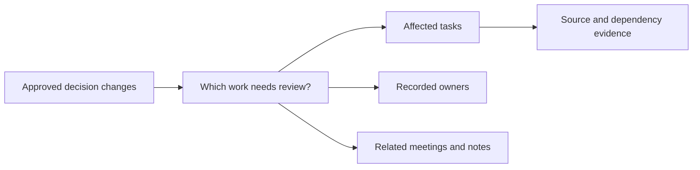
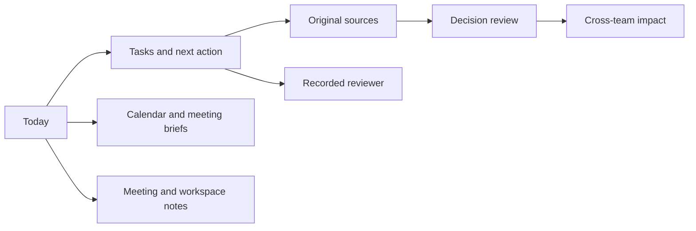
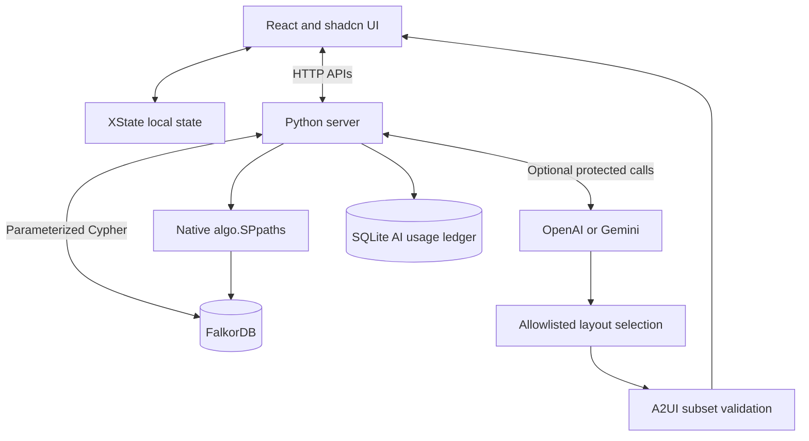
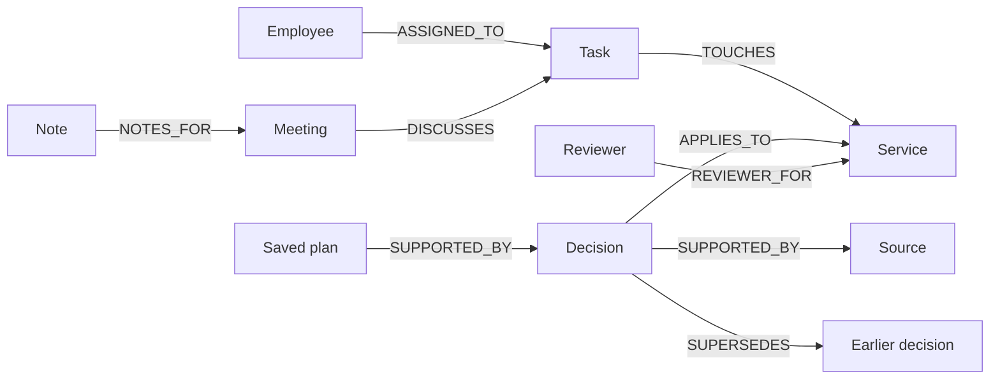
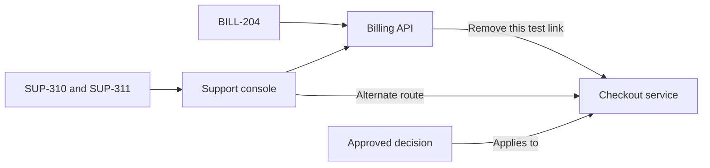
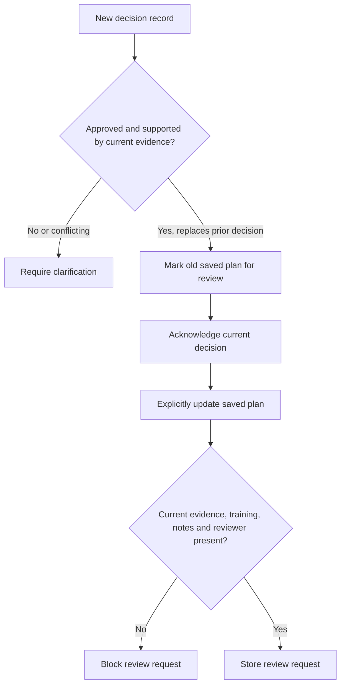

# Workweave

**Company Brain · FalkorDB hackathon · Solo project**

A company workspace that connects work to the decisions and sources behind it.

**Main message:** When a decision changes, employees need to know which work needs review, who owns it, and why.

---

## 1. The problem

Tasks, calendar events, meeting notes and decisions are separate records. A document can be readable but out of date. The latest meeting can discuss a proposal without approving it.

Workweave follows recorded relationships instead of treating the newest text as authority.

**Say:** “We connect company context to work, so a changed decision has a traceable effect.”

## 2. The employee product

Today, Tasks, Calendar, Notes, Knowledge and People share one workspace. Decision review and Cross-team impact explain changes. The header starts an optional 11-stop application tour.

**Show:** Open a meeting brief, its linked note, then an assigned task. All company records come from the server.

## 3. System design

- **FalkorDB:** company relationships, decisions, evidence and saved work.
- **XState:** local interface state, including tour progress.
- **AI:** selects a supported layout after a fixed graph tool call. It does not invent displayed facts or write arbitrary Cypher.
- **SQLite:** paid AI operation limits; it is not the company knowledge store.

## 4. The graph model

A saved plan keeps its decision identity. Replacement does not erase the old plan or its notes. A recorded reviewer is required; missing ownership is not guessed.

## 5. Main proof: change a link, keep the text

The synthetic source exports include Jira tasks, Google Calendar events and Zoom notes. Exact source identifiers link records. These are normalized sample exports, not live vendor integrations.

| State | Billing task | Support tasks | Source text |
|---|---|---|---|
| Link present | Affected | Affected through two routes | Unchanged |
| Link removed | No longer reached | Still affected through one route | Unchanged |
| Link restored | Affected again | Two routes restored | Unchanged |

**Show:** `/judge` → one-minute proof → remove → restore. Check task IDs, route counts and source content hashes.

**Why FalkorDB matters:** bounded Cypher finds dependency routes; native shortest-path queries explain them. The result changes when relationships change. An equivalent relationship model in SQL could also solve this; we make no database exclusivity claim.

## 6. Decisions, authority and safe actions

**Key distinction:** Acknowledgement records reading. It does not update the plan. Newer proposals do not replace approved guidance. Stored requests do not send email.

## 7. Evidence and limits

- Previous backend validation: **60 tests**.
- Current frontend validation: **4 tests** and a production build.
- Authored checks: **7 impact cases**, **4 relationship cases**, **8 graph retrieval cases**.
- Browser checks cover the graph proof and all 11 application tour stops.
- These are small synthetic checks, not production accuracy or scale benchmarks.
- No production login, permission-aware retrieval or live source sync.
- AI access is invite-gated; keys stay on the server. Operation limits are not a guaranteed dollar cap.
- Public hosting, final video and participant technical review remain release tasks.

## 8. The submission story

**Lead with:** “One approved decision changes. Workweave finds the affected work and shows why.”

**Demo order:** problem → cross-team paths → link removal and restoration → stale plan → query evidence → limits.

**Close with:** “FalkorDB connects the decision, its source and the work that depends on it. Employees can check the evidence before they act.”

**Disclosure:** Codex assisted with code, tests, design and documentation. The participant must verify the work and explain the technical choices. No award is guaranteed.
